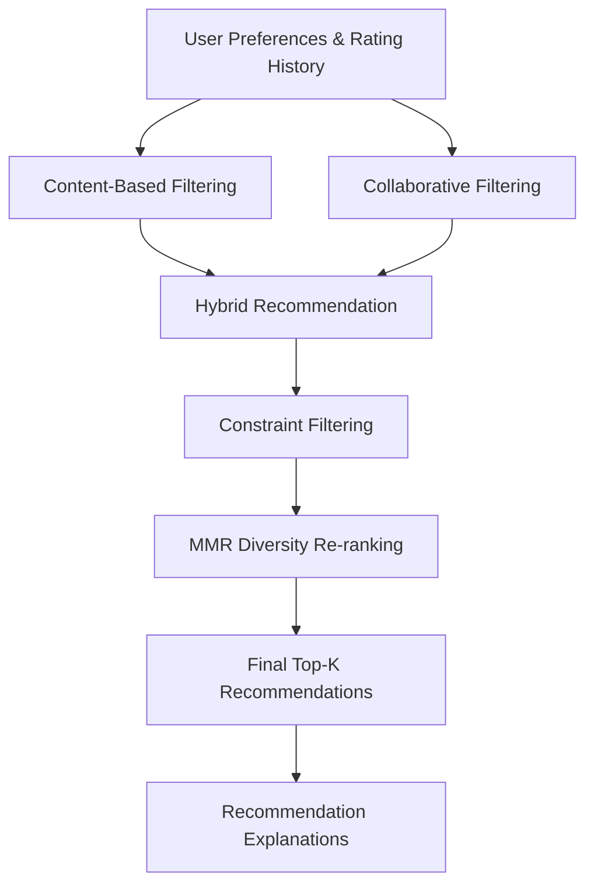

# 🎬 CineXplain — Intelligent Movie Recommendation System

**A personalized movie recommendation system that combines content similarity, collaborative filtering, hybrid ranking, recommendation diversity, and user-defined constraints.**

CineXplain helps users discover movies based on their interests and viewing preferences. Instead of relying on a single recommendation technique, it combines multiple recommendation approaches to generate relevant, diverse, and personalized movie suggestions.

---

## 📌 Table of Contents

- [Overview](#overview)
- [Key Features](#key-features)
- [System Architecture](#system-architecture)
- [Recommendation Pipeline](#recommendation-pipeline)
- [Technology Stack](#technology-stack)
- [Project Structure](#project-structure)
- [Getting Started](#getting-started)
- [Dataset Setup](#dataset-setup)
- [Running the Application](#running-the-application)
- [Running Individual Modules](#running-individual-modules)
- [Evaluation](#evaluation)
- [Team Contributions](#team-contributions)
- [Limitations](#limitations)
- [Acknowledgements](#acknowledgements)

---

## 1. Overview

Traditional movie recommendation systems often rely on a single approach, which can lead to repetitive recommendations or fail to capture different aspects of user preferences.

CineXplain addresses this problem through a multi-stage recommendation architecture.

The system combines:

- **Content-Based Filtering:** Identifies movies with similar genres, descriptions, cast, and other metadata.
- **Collaborative Filtering:** Discovers patterns from user ratings and preferences.
- **Hybrid Recommendation:** Combines content-based and collaborative scores using adaptive weighting.
- **Maximal Marginal Relevance (MMR):** Improves recommendation diversity by reducing repetitive selections.
- **Constraint Satisfaction (CSP):** Applies user-defined restrictions such as excluded genres, release-year ranges, and franchise limits.

The project also provides an interactive Streamlit application where users can build a movie preference profile and explore personalized recommendations.

## 2. Key Features

| Feature | Description |
|---|---|
| Content-Based Recommendations | Uses TF-IDF and sentence embeddings to identify similar movies. |
| Collaborative Filtering | Implements Item-Item KNN and SVD using user rating patterns. |
| Adaptive Hybrid Ranking | Combines content and collaborative recommendation scores. |
| Recommendation Diversity | Uses MMR to balance relevance and diversity. |
| User Constraints | Filters recommendations according to user preferences. |
| Personalized Profiles | Supports liked and disliked movies. |
| Recommendation Explanations | Provides reasons behind recommended movies. |
| Interactive Interface | Offers a Streamlit-based application with configurable filters. |
| Evaluation Framework | Measures recommendation quality using ranking and prediction metrics. |

## 3. System Architecture

CineXplain follows a modular architecture in which each component handles a specific recommendation task.

### High-Level Architecture



### Main Components

**1. Content-Based Filtering**

Analyzes movie metadata such as titles, genres, plots, and cast information. It uses TF-IDF and sentence embeddings to represent movies and calculate content similarity.

**2. Collaborative Filtering**

Learns from user-item rating patterns using two algorithms:

- Item-Item KNN
- Matrix Factorization (SVD)

**3. Hybrid Recommendation**

Combines content-based and collaborative scores using adaptive weighting. The weighting strategy gives greater importance to content-based recommendations when user interaction history is limited.

**4. MMR Diversity Re-ranking**

Uses Maximal Marginal Relevance to reduce similarity among selected movies while preserving recommendation relevance.

**5. Constraint Satisfaction**

Applies user-defined restrictions, including genre exclusions, release-year ranges, and franchise limits.

### Interactive Application Pipeline

The current Streamlit implementation follows this execution order:

1. Generate content-based scores.
2. Generate collaborative scores using a lightweight item-item model (or popularity fallback).
3. Combine the scores using hybrid ranking.
4. Apply user constraints.
5. Apply MMR diversity re-ranking.
6. Display recommendations with explanations.

The offline experimental implementations of the individual modules are maintained separately for development and evaluation.

## 4. Recommendation Pipeline

### Content-Based Filtering

The content-based module represents movies using their available metadata.

**Techniques:**
- TF-IDF Vectorization
- Sentence Embeddings
- Cosine Similarity

**Implementation:** `src/content_recommender.py`

### Collaborative Filtering

The collaborative filtering module learns from user rating behaviour.

**Algorithms:**
- Item-Item KNN using Adjusted Cosine Similarity.
- SVD-based Matrix Factorization using Gradient Descent.

**Implementation:** `src/collaborative_recommender.py`

### Hybrid Recommendation

The hybrid module combines content and collaborative recommendation scores.

The adaptive weighting strategy is:

\[
\alpha = \frac{k}{k+n}
\]

\[
S_{hybrid} =
\alpha S_{content} +
(1-\alpha)S_{collaborative}
\]

Where:

- \(n\) represents the number of user interactions.
- \(k\) is the weighting parameter.
- \(\alpha\) determines the content-based weight.
- \(1-\alpha\) determines the collaborative filtering weight.

**Implementation:** `src/hybrid_recommender.py`

### Diversity Re-ranking

MMR selects movies by balancing relevance and similarity to already selected movies.

\[
MMR(d)=
\lambda Rel(d)-
(1-\lambda)\max_{s\in S}Sim(d,s)
\]

Where:

- \(Rel(d)\) represents recommendation relevance.
- \(Sim(d,s)\) measures movie similarity.
- \(\lambda\) controls the relevance-diversity trade-off.

**Implementation:** `src/mmr.py`

### Constraint Satisfaction

The constraint module filters recommendations based on user-defined conditions, such as:

- Excluding specific genres.
- Restricting release years.
- Limiting movies from the same franchise.

**Implementation:** `src/constraints.py`

---

## 5. Technology Stack

| Category | Technologies |
|---|---|
| Programming Language | Python |
| Data Processing | Pandas, NumPy |
| Machine Learning | Scikit-learn |
| Collaborative Filtering | SciPy Sparse Matrices, Matrix Factorization |
| Natural Language Processing | TF-IDF, Sentence Transformers |
| Similarity Computation | Cosine Similarity |
| Visualization | Matplotlib |
| Web Application | Streamlit |
| Testing | Pytest |
| Version Control | Git and GitHub |

---

## 6. Project Structure

```text
cineXplain/
│
├── app.py
│
├── data/
│   ├── movies.csv
│   ├── ratings.csv
│   ├── links.csv
│   ├── movies_enriched.csv
│   └── cache/
│
├── src/
│   ├── content_recommender.py
│   ├── collaborative_recommender.py
│   ├── hybrid_recommender.py
│   ├── hybrid_interface.py
│   ├── score_integration.py
│   ├── mmr.py
│   ├── constraints.py
│   ├── recommender.py
│   └── streamlit_engine.py
│
├── evaluation/
│   ├── content_metrics.py
│   ├── collaborative_metrics.py
│   ├── hybrid_metrics.py
│   ├── mmr_metrics.py
│   ├── results_content.csv
│   └── results_collaborative.csv
│
├── notebooks/
│   ├── eda.ipynb
│   ├── 02_collaborative_filtering.ipynb
│   ├── demo.ipynb
│   └── 05_csp_integration.ipynb
│
├── scripts/
│   ├── load_movielens.py
│   ├── enrich_metadata.py
│   ├── create_train_test_split.py
│   ├── build_user_interactions.py
│   └── generate_hybrid_recommendations.py
│
├── tests/
│   ├── test_cf_integration.py
│   ├── test_hybrid.py
│   ├── test_constraint.py
│   ├── test_score_integration.py
│   └── test_final_evaluation.py
│
├── docs/
│   ├── member1_content_based.md
│   ├── member2_collaborative_filtering.md
│   ├── member3_hybrid.md
│   ├── member4_mmr_report.md
│   └── member_5_CSP_system_integration.md
│
├── reports/
├── requirements.txt
├── .gitignore
└── README.md
```

---

## 7. Getting Started

### Prerequisites

Make sure the following are installed:

- Python 3.10 or newer
- pip
- Git

### Step 1: Clone the Repository

```bash
git clone https://github.com/KotapatiSaiMounika/cineXplain.git

cd cineXplain
```

### Step 2: Create a Virtual Environment

```bash
python3 -m venv .venv
```

Activate it:

**Linux / macOS**

```bash
source .venv/bin/activate
```

**Windows**

```bash
.venv\Scripts\activate
```

### Step 3: Install Dependencies

```bash
python -m pip install --upgrade pip

pip install -r requirements.txt
```

---

## 8. Dataset Setup

CineXplain uses the MovieLens dataset provided by GroupLens.

**Dataset:** [MovieLens 32M](https://grouplens.org/datasets/movielens/)

Download the dataset and extract the following files:

| File | Description |
|---|---|
| `movies.csv` | Movie IDs, titles, and genres |
| `ratings.csv` | User IDs, movie IDs, and ratings |
| `links.csv` | MovieLens-to-external movie identifiers |

Create a `data/` directory in the project root and place the files inside it:

```text
cineXplain/
└── data/
    ├── movies.csv
    ├── ratings.csv
    └── links.csv
```

### Optional: Enrich Movie Metadata

MovieLens provides basic movie information. Additional metadata such as plots, cast, and franchise information can be obtained using the TMDB API.

1. Create an API key through [TMDB](https://www.themoviedb.org/settings/api).
2. Configure the API key as an environment variable.

**Linux / macOS**

```bash
export TMDB_API_KEY=your_api_key
```

**Windows PowerShell**

```powershell
$env:TMDB_API_KEY="your_api_key"
```

Test the enrichment process on a small number of movies:

```bash
python scripts/enrich_metadata.py --limit 50
```

Generate the enriched metadata:

```bash
python scripts/enrich_metadata.py
```

The generated file is:

```text
data/movies_enriched.csv
```

This enrichment is optional. The content-based module can also work with movie titles and genres when additional metadata is unavailable.

For more details, see [Content-Based Filtering Documentation](docs/member1_content_based.md).

---

## 9. Running the Application

After placing at least `movies.csv` inside the `data/` directory, start the application:

```bash
streamlit run app.py
```

Open the local URL displayed in your terminal (usually `http://localhost:8501`).

### Using CineXplain

1. Load your movie catalogue and rating data.
2. Select movies you enjoyed.
3. Optionally select movies you did not enjoy.
4. Choose the number of recommendations.
5. Adjust the relevance-diversity preference.
6. Apply genre and release-year restrictions.
7. Generate personalized recommendations.

### Application Capabilities

- Personalized movie recommendations.
- Content and collaborative recommendation scores.
- Hybrid ranking.
- Diversity-aware recommendations.
- Genre and release-year filtering.
- Movie details and recommendation explanations.
- Comparison of hybrid ranking and MMR results.
- CSV export of recommendations.

The application also supports uploading MovieLens-compatible CSV files through its sidebar after it has started.

---

## 10. Running Individual Modules

CineXplain maintains individual implementations and evaluation scripts for experimentation.

### Content-Based Recommendation

```bash
python src/content_recommender.py \
    --movie "Toy Story" \
    --method both \
    --k 10
```

Available methods:

- `tfidf`
- `embeddings`
- `both`

### Collaborative Filtering

Run the evaluation metric self-test:

```bash
python evaluation/collaborative_metrics.py
```

Run the collaborative filtering implementation:

```bash
python src/collaborative_recommender.py
```

The module implements Item-Item KNN and SVD and exposes a common `get_cf_scores()` interface for hybrid experiments.

### Hybrid Recommendation

Refer to:

- `src/hybrid_recommender.py`
- `src/hybrid_interface.py`
- `evaluation/hybrid_metrics.py`

### MMR Diversity

Refer to:

- `src/mmr.py`
- `evaluation/mmr_metrics.py`
- `docs/member4_mmr_report.md`

### Constraint Satisfaction

Refer to:

- `src/constraints.py`
- `src/csp_demo.py`
- `notebooks/05_csp_integration.ipynb`

---

## 11. Evaluation

The project includes evaluation frameworks to measure recommendation quality and compare different recommendation approaches.

### Evaluation Metrics

| Metric | Purpose | Preferred Value |
|---|---|---|
| RMSE | Measures rating prediction error | Lower |
| MAE | Measures average absolute prediction error | Lower |
| Precision@K | Measures relevant recommendations among the top K | Higher |
| Recall@K | Measures how many relevant movies were retrieved | Higher |
| NDCG@K | Evaluates ranking quality and relevance positions | Higher |
| ILD | Measures diversity within a recommendation list | Higher |

### Collaborative Filtering Results

The following results were obtained from the offline MovieLens working-set experiments.

| Metric | Item-Item KNN | SVD | Popularity |
|---|---:|---:|---:|
| RMSE | 0.913 | **0.796** | — |
| MAE | 0.701 | **0.601** | — |
| Precision@10 | **0.215** | 0.144 | 0.119 |
| Recall@10 | **0.184** | 0.113 | 0.099 |
| NDCG@10 | **0.288** | 0.184 | 0.154 |

**Key observations:**

- SVD achieved better rating prediction accuracy.
- Item-Item KNN achieved better ranking performance.
- Both collaborative filtering approaches outperformed the popularity baseline on the reported ranking metrics.

The KNN and SVD RMSE results have different prediction coverage, so they should not be interpreted as a strictly like-for-like comparison.

### Evaluation Resources

- `evaluation/` — Evaluation implementations and result files.
- `notebooks/` — Experiments, visualizations, and model comparisons.
- `reports/` — Additional experiment reports and result summaries.

For individual evaluation methodologies and detailed results, refer to the respective module documentation.

---

## 12. Team Contributions

CineXplain was developed collaboratively, with each team member responsible for a dedicated component of the recommendation pipeline.

| Member | Responsibility | Main Implementation |
|---|---|---|
| Member 1 | Content-Based Filtering | `src/content_recommender.py` |
| Member 2 | Collaborative Filtering | `src/collaborative_recommender.py` |
| Member 3 | Hybrid Recommendation | `src/hybrid_recommender.py` |
| Member 4 | MMR Diversity Re-ranking | `src/mmr.py` |
| Member 5 | CSP and System Integration | `src/constraints.py`, `src/recommender.py` |

### Detailed Technical Documentation

Each module has its own documentation covering implementation details, design decisions, evaluation, and limitations.

- [Member 1 – Content-Based Filtering](docs/member1_content_based.md)
- [Member 2 – Collaborative Filtering](docs/member2_collaborative_filtering.md)
- [Member 3 – Hybrid Recommendation](docs/member3_hybrid.md)
- [Member 4 – MMR Diversity Re-ranking](docs/member4_mmr_report.md)
- [Member 5 – CSP and System Integration](docs/member_5_CSP_system_integration.md)

---

## 13. Limitations

The current implementation has several limitations:

- Recommendation quality depends on the availability and quality of movie metadata and user ratings.
- Collaborative filtering has limited coverage for new users and rarely rated movies.
- The offline collaborative filtering experiments use a reduced working set rather than the complete MovieLens catalogue.
- Content-based recommendations can be affected by missing or incomplete movie metadata.
- The recommendation pipeline depends on the selected relevance-diversity trade-off.
- Evaluation results are based on defined experimental splits and should not be treated as guarantees of real-world user satisfaction.

The offline experimental CF module and the lightweight collaborative model used in the Streamlit application serve different purposes. The former supports model evaluation and hybrid experiments, while the latter is designed for responsive interactive recommendations.

**CineXplain — Discover movies that match your taste, without limiting your choices.**
